# Отчет

### Стек
Зависимости закреплены через == и ставятся до копирования кода; app ждет healthy db и cache через depends_on.

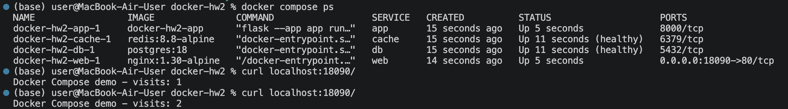

### Том БД
К db подключен именованный том pgdata (путь /var/lib/postgresql для postgres 18). После пересоздания контейнера db заметка сохранилась. Заметки хранятся в томе, а счетчик Redis временный: его можно потерять

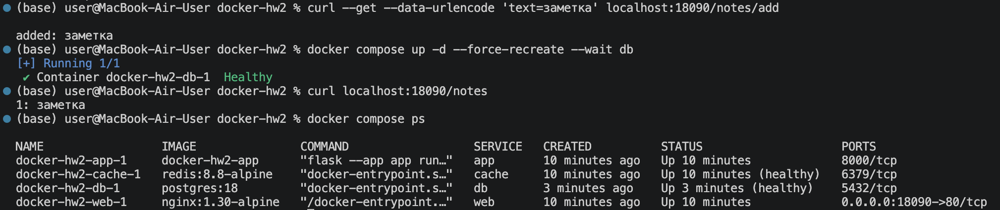

### Бэкап
Остановила стек через down без -v (том остался), временным контейнером alpine упаковала том в backup/pgdata.tgz, удалила том, создала заново через docker compose create и распаковала архив. После запуска стека контрольная заметка на месте

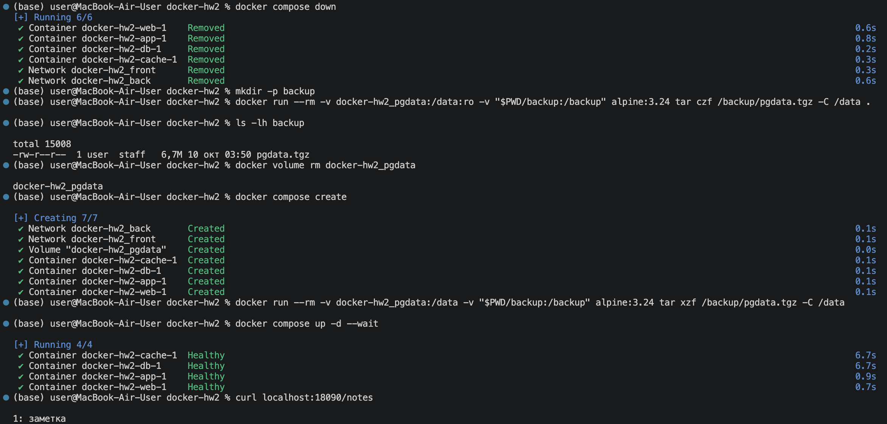

### Сети
web в сети front, db и cache в back, app в обеих. Из nginx имя db не находится и TCP до IP базы не проходит; из app база и кеш доступны

app подключен к обеим сетям, поэтому сам ходит в db. Но пересылать пакеты от web в back он не будет: пересылка в контейнере выключена, а Docker не пропускает трафик между разными сетями

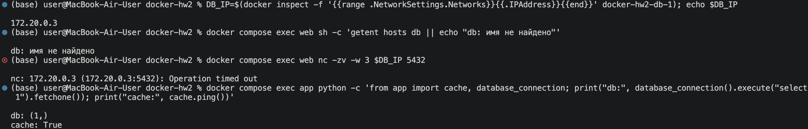

### Переменные и имя проекта
Пароль, имя БД и порт берутся из .env; в git идет .env.example, а .env исключен в .gitignore. В выводе config пароль скрыт

Имя проекта задано полем name: docker-hw2. Приоритет: флаг -p, переменная COMPOSE_PROJECT_NAME, поле name:, имя папки. Из имени строятся имена ресурсов: контейнеры `docker-hw2-<сервис>-1`, сети docker-hw2_front и docker-hw2_back, том docker-hw2_pgdata

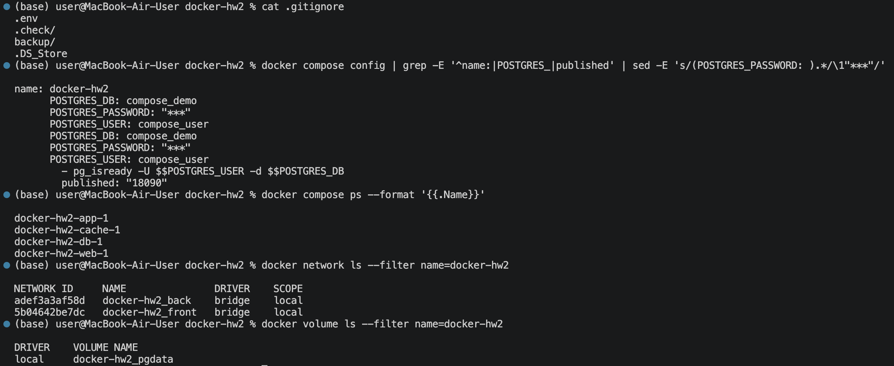

down удаляет контейнеры и сети, том остается; down -v удаляет и том

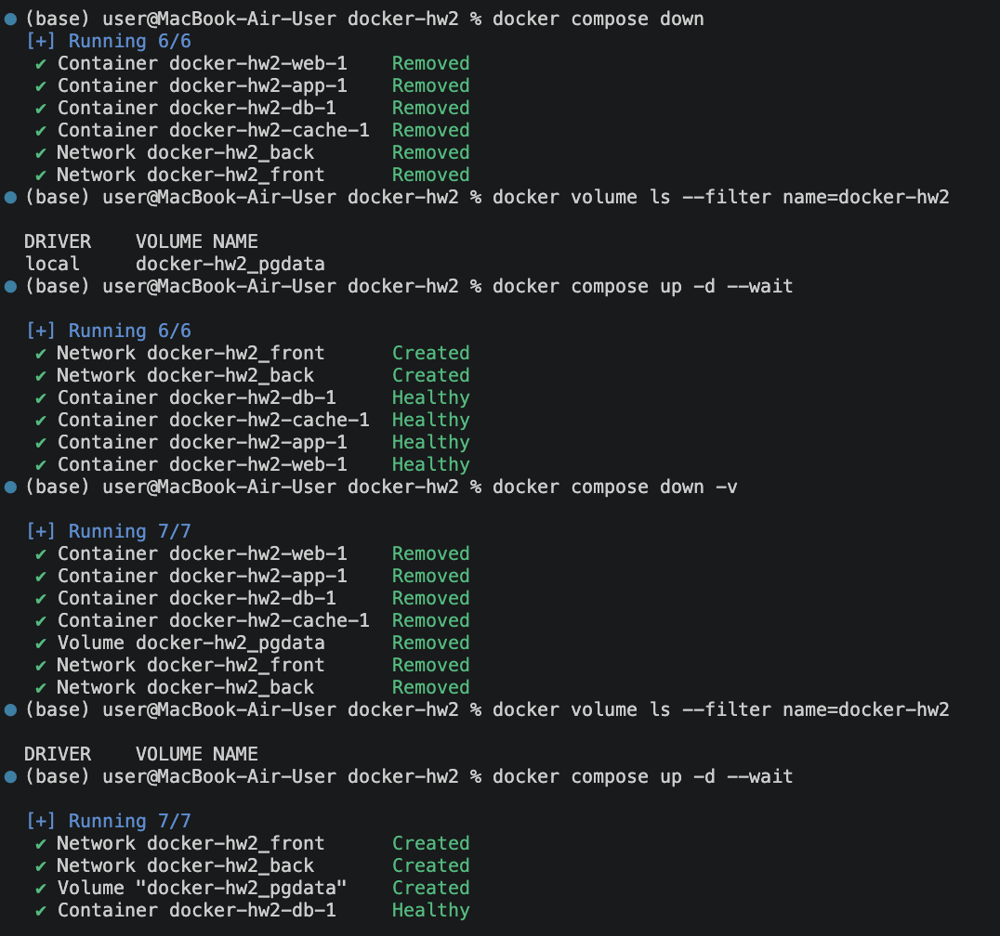

### dive
Версии: Docker 27.5.1, dive 0.13.1. До это Dockerfile.before, после это Dockerfile

| | до | после |
|---|---|---|
| Размер | 765 MB | 270 MB |
| efficiency | 80,0 % | 98,0 % |
| wastedBytes | 148 MB | 5,7 MB |
| userWastedPercent | 33,9 % | 6,2 % |
| Результат | FAIL | PASS |

В до build-essential ставится и удаляется в разных слоях, поэтому его файлы остаются в образе; так же остаются списки apt и кеш pip, а код копируется до установки зависимостей. В после компилятор не нужен (у библиотек есть готовые wheel), pip без кеша, requirements.txt копируется до кода

Поведение то же: тот же базовый образ, те же версии библиотек, тот же код и CMD; на образе после работает весь стек выше. PASS значит только, что потерянных байтов мало, а не что образ минимальный: 270 MB в основном занимает базовый образ python

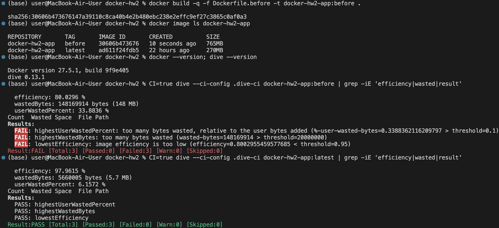

### Звездочка (override и watch)

Базовая конфигурация это только compose.yaml; объединенная это compose.yaml + compose.override.yaml, который Compose подключает сам. Override добавляет к app подключение папки app/, запуск flask --debug и develop.watch

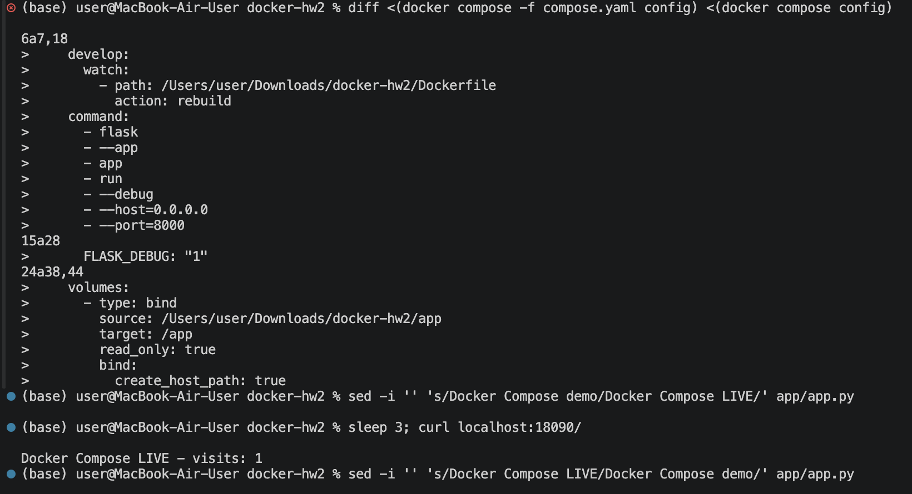

Правка app.py применилась без пересборки (ответ LIVE). При изменении Dockerfile watch пересобрал образ: Rebuilding service "app", service "app" successfully built

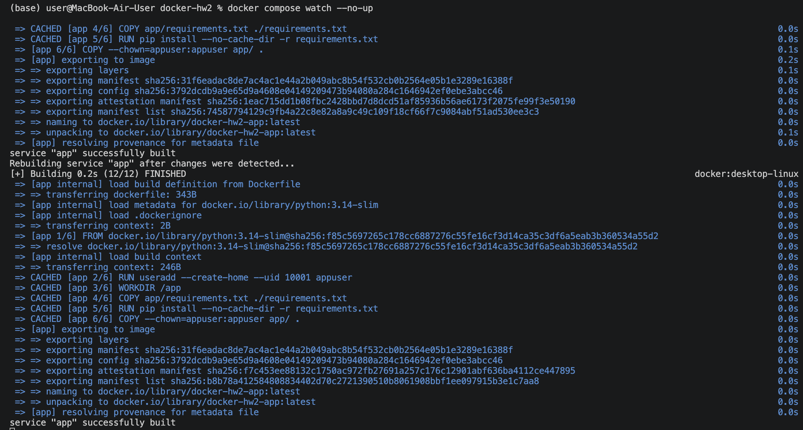

### Звездочка (dive в GitHub Actions)
Workflow собирает образ и запускает dive с CI=true и порогами из .dive-ci, без || true. На main job проходит:

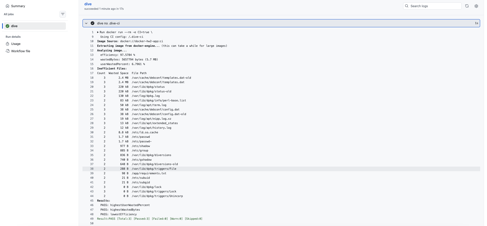

В ветке dive-fail Dockerfile заменен на Dockerfile.before, dive вернул код 1 и job упал:

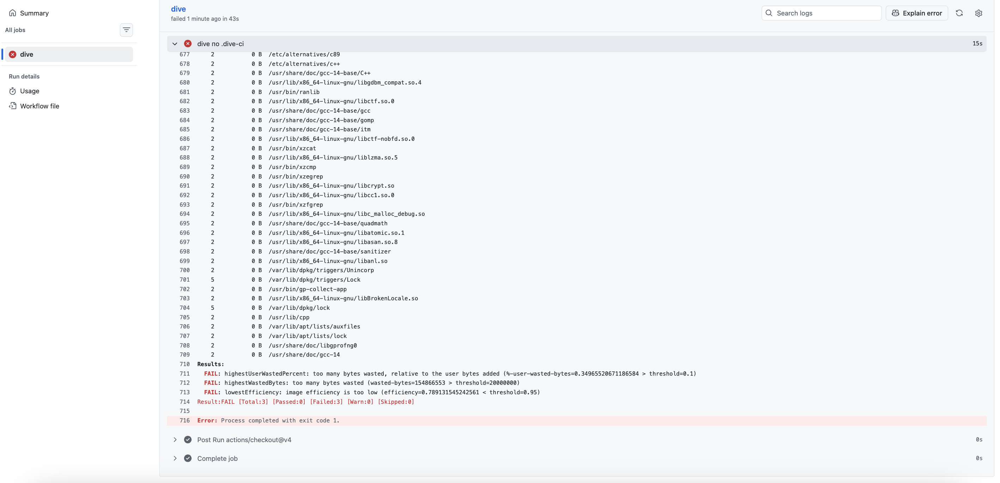

